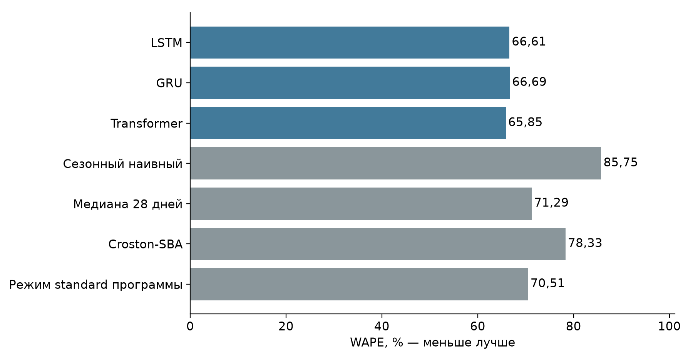
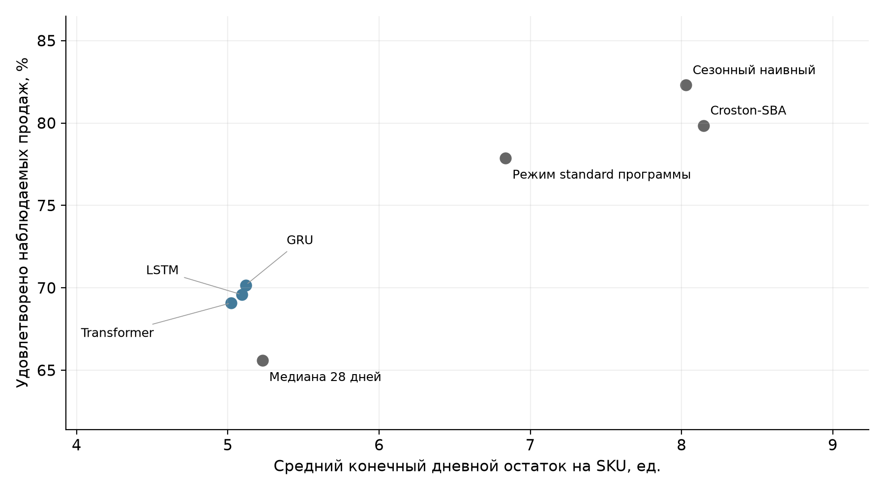

# Проверка точности и последствий для запасов

Расчёт выполнен 01.11.2026. Фактические результаты обучения и имитации; данные целевой организации отсутствуют.

## 3.12 Протокол внешней проверки на продовольственных продажах

Для внешней проверки выбраны реальные ежедневные продажи продовольственных товаров M5 [17, 18]. Источник — Walmart; использована открытая копия набора Nixtla. Проверка относится к одному магазину CA_1 и трём отделам FOODS_1, FOODS_2 и FOODS_3. Из каждого отдела до расчёта тестовых показателей отобрано по 20 товаров. Условиями допуска служили положительные продажи в первые 90 дней обучения и не менее 60 дней с продажами в 2015 г.; порядок отбора задан SHA-256 идентификатора товара. Будущие продажи не участвовали в отборе.

Обучение выполнено на периоде 01.01.2014–31.12.2015, выбор checkpoint — на периоде 01.01.2016–27.03.2016. Отложенная проверка охватывает 28.03.2016–22.05.2016: 60 SKU, 56 дней и 6402 проданных единиц. Для точности использованы два неперекрывающихся 28-дневных прогноза с началами 28.03 и 25.04.2016. Перед вторым прогнозом обновлялась только доступная история; веса не дообучались. Нормализация оценена исключительно по обучению. Вход содержит 90 прошедших дней и 14 признаков. Неизвестные ведущие цены заменены нулём, остальные пропуски заполнены только вперёд по времени. SNAP в исходном наборе обозначает программу продовольственной помощи, а не скидочную акцию; признак сохраняет это значение при отображении в общую схему данных.

Новый эксперимент использует текущую параметризацию zero_inflated_lognormal_v3: вероятность положительной продажи и параметры логнормального распределения её величины. Обучение минимизирует отрицательное логарифмическое правдоподобие смеси с массой в нуле. Это отличается от положительных приращений softplus_increments_v2 в архивном UCI-исследовании подразделов 3.4–3.9. Результаты двух наборов нельзя использовать для изолированной оценки эффекта замены параметризации: одновременно изменились данные и условия обучения.

Для каждой архитектуры выполнены три запуска с seed 42, 43 и 44. Ширина представления равна 32, batch size — 128, Adam learning rate — 0,001, максимум — 40 эпох, patience — 6. Сохранён checkpoint с минимальной потерей на проверочном периоде; тест не использовался при его выборе. Для обучения сформировано 2640 окон с шагом 14 дней, для проверки — 480 окон с шагом 7 дней. Операционный нейросетевой прогноз заранее определён как среднее соответствующих квантилей трёх запусков. Показатели ансамбля и среднее ошибок отдельных запусков не отождествляются.

Таблица 14 — Повторы обучения и вычислительный бюджет

| Модель | WAPE запусков, % | Лучшая эпоха | Лимит эпох | Время, с |
|---|---|---|---|---|
| LSTM | 66,71 ± 0,30 | 37/38/40 | 3 из 3 | 28,76 |
| GRU | 66,73 ± 0,15 | 38/39/37 | 3 из 3 | 73,87 |
| Transformer | 66,06 ± 0,04 | 31/34/28 | 0 из 3 | 513,77 |

В таблице 14 приведены среднее и выборочное стандартное отклонение WAPE трёх отдельных запусков, лучшие эпохи в порядке seed 42/43/44 и суммарное время обучения. Достижение максимума эпох отмечается отдельно. Такие запуски ограничены вычислительным бюджетом; их нельзя объявлять сошедшимися только по факту завершения программы. Время измерено на текущем CPU и не сопоставляется напрямую с архивными замерами другой среды.

## 3.13 Точность, интервалы и неопределённость сравнения

Минимальный WAPE среди семи методов получен методом «Transformer»: 65,85 %. Лучший нейросетевой ансамбль — Transformer с WAPE 65,85 %. Сезонный наивный метод имеет WAPE 85,75 %. Показатель WAPE рассчитан как отношение суммы абсолютных ошибок к сумме фактических продаж; RMSE приведён в единицах товара, Bias показывает направление смещения. Интервальное покрытие приведено только для нейросетей: повторённый точечный прогноз базового метода не является вероятностным интервалом. Покрытие ансамблей составляет 86,40–89,20 % при номинальных 80 %, что не подтверждает точную калибровку. Усреднение квантилей даёт эмпирически проверяемые границы, но не точные квантили смеси трёх предиктивных распределений.

Таблица 15 — Точность внешней проверки M5

| Метод | WAPE, % | RMSE, ед. | Bias, % | Покрытие, % |
|---|---|---|---|---|
| LSTM | 66,61 | 2,44 | -33,80 | 88,45 |
| GRU | 66,69 | 2,45 | -33,02 | 89,20 |
| Transformer | 65,85 | 2,40 | -34,83 | 86,40 |
| Сезонный наивный | 85,75 | 2,86 | -2,59 | — |
| Медиана 28 дней | 71,29 | 2,78 | -36,58 | — |
| Croston-SBA | 78,33 | 2,74 | -5,72 | — |
| Режим standard программы | 70,51 | 2,41 | -13,96 | — |



Для описания неопределённости выполнены 10 000 парных bootstrap-перевыборок SKU с seed 20261101. В одной перевыборке сохраняются все 56 дней каждого выбранного товара. Разности рассчитаны относительно сезонного наивного метода; отрицательная разность WAPE означает меньшую ошибку, положительная разность уровня обслуживания — больший удовлетворённый объём. Интервалы являются точечными описательными 95%-ными интервалами для данной выборки и периода. Товары одного магазина могут быть зависимыми; межмагазинная и межпериодная неопределённость не оценена, поправка на множественные сравнения не применялась. Поэтому интервалы не служат основанием для универсального утверждения о превосходстве архитектуры.

Таблица 16 — Разности относительно сезонного наивного метода

| Метод | ΔWAPE, п.п. | 95% ДИ | Δсервис, п.п. | 95% ДИ |
|---|---|---|---|---|
| LSTM | -19,15 | [-28,24; -12,43] | -12,71 | [-18,43; -8,25] |
| GRU | -19,06 | [-28,37; -12,20] | -12,14 | [-17,43; -7,95] |
| Transformer | -19,90 | [-28,48; -13,32] | -13,21 | [-19,88; -8,31] |
| Медиана 28 дней | -14,46 | [-27,31; -4,35] | -16,71 | [-23,49; -11,65] |
| Croston-SBA | -7,43 | [-20,55; 7,94] | -2,45 | [-8,79; 1,54] |
| Режим standard программы | -15,25 | [-24,49; -6,87] | -4,44 | [-10,26; 0,38] |

## 3.14 Проверка последствий для товарных запасов

Связь прогноза с запасами проверена отдельной имитацией, использующей тот же ml.purchasing.plan_order, что и программа. Все методы имеют одинаковые начальные остатки и ограничения заказа: упаковка и минимальный заказ равны одной единице. Начальный остаток каждого SKU равен округлённому вверх среднему за 28 дней до теста, умноженному на сумму срока поставки и интервала пересмотра. Поступление проводится перед продажами через заданное число дней после заказа; дефицит трактуется как потерянная продажа без последующего исполнения. Каждый день модель получает одну и ту же доступную историю реальных продаж. Обратная связь через смоделированные потерянные продажи отключена: это контролируемое сопоставление прогнозов, а не имитация наблюдаемости продаж при реальном внедрении.

Заранее заданы 12 сценариев: срок поставки 1, 3 или 7 дней, пересмотр каждые 1 или 7 дней, дополнительное покрытие 0 или 7 дней. Основной сценарий выбран до расчёта: поставка 3 дня, пересмотр раз в 7 дней, дополнительное покрытие 0 дней. Ежедневные прогнозы для принятия решения сохраняются отдельно; для точности по-прежнему используются только два неперекрывающихся блока. Уровень обслуживания равен доле фактически удовлетворённого объёма в исторических продажах. Средний остаток — среднее значение запаса после продаж в конце дня, сначала по дням, затем по SKU. Конечные заказы в пути учитываются отдельно, а не признаются поступившими. Для каждой траектории проверяются балансы наличного запаса, заказов в пути и продаж.

Таблица 17 — Основной сценарий пополнения: L3, R7, S0

| Метод | Сервис, % | Дефицит, ед. | Остаток, ед. | Заказов |
|---|---|---|---|---|
| LSTM | 69,59 | 1947 | 5,09 | 261 |
| GRU | 70,17 | 1910 | 5,12 | 269 |
| Transformer | 69,09 | 1979 | 5,02 | 246 |
| Сезонный наивный | 82,30 | 1133 | 8,03 | 317 |
| Медиана 28 дней | 65,59 | 2203 | 5,23 | 223 |
| Croston-SBA | 79,85 | 1290 | 8,14 | 386 |
| Режим standard программы | 77,87 | 1417 | 6,84 | 384 |

В основном сценарии сезонный наивный метод удовлетворяет 82,30 % исторических продаж при среднем остатке 8,03 ед. на SKU. Ансамбль Transformer даёт соответственно 69,09 % и 5,02 ед. Эти два показателя рассматриваются совместно: увеличение удовлетворённого объёма за счёт большего остатка не является доказательством экономии. В данном случае нейросетевой прогноз уменьшает остаток ценой большего дефицита: улучшение WAPE не означает улучшение уровня обслуживания. Выраженное отрицательное смещение медианы согласуется с этим результатом. Для закупочной задачи требуется отдельный выбор целевого квантиля или уровня покрытия на проверочном периоде и новая отложенная оценка; оптимальное правило нельзя выбирать по уже раскрытому тесту. Полные результаты всех сценариев сохранены в inventory-summary.csv; основной сценарий не заменялся более благоприятным после просмотра результата.



Полученные числа подтверждают воспроизводимость вычислений на внешних продовольственных продажах и условные последствия одинаковой политики пополнения. Они не подтверждают внедрение или экономический эффект в Караганде. M5 не содержит использованных здесь фактических остатков, сроков поставки, партий и списаний; исторические продажи служат приближением спроса и могут быть ограничены неизвестным наличием. Срок годности, списания, сбои поставок, ёмкость склада, бюджет и денежные издержки в этой имитации не моделируются. 56 дней и один магазин не представляют все сезоны и рынки. Для расчёта эффекта в тенге нужны реальные закупочные цены, маржа, остатки, списания и журнал поставок целевой организации. Данные БНС по Караганде о ценах и агрегатах торговли не заменяют ежедневные продажи SKU и не использовались для создания искусственного локального эффекта.

## Вывод для диссертации

Выполнена дополнительная внешняя проверка на 60 продовольственных SKU M5: девять фактических обучений, два неперекрывающихся прогнозных блока и 12 одинаковых сценариев пополнения. Минимальный WAPE в этой проверке составляет 65,85 % у метода «Transformer». Сопоставление точности с уровнем обслуживания и остатком показывает необходимость оценивать прогноз вместе с правилом закупки. В основном сценарии Transformer снижает WAPE относительно сезонного наивного метода на 19,90 п.п., но уровень обслуживания ниже на 13,21 п.п.; преимущество закупки по его медиане не подтверждено. Архивный результат UCI и новый эксперимент v3 представлены раздельно; абсолютные значения между источниками не интерпретируются как эффект обновления модели. Обоснована пригодность разработанного конвейера для воспроизводимого сравнения и подготовки ограниченного пилота. Экономия и результат внедрения в целевой организации требуют отдельного наблюдаемого подтверждения.

## Воспроизведение

Из корня проекта, при установленном PyTorch и исследовательских зависимостях:

```powershell
Invoke-WebRequest https://raw.githubusercontent.com/Nixtla/m5-forecasts/main/datasets/m5.zip -OutFile m5.zip
python -m ml.research.external_validation --archive m5.zip --output storage/app/external-validation
python -m ml.research.verify_external_validation --report storage/app/external-validation
```

SHA-256 исходного ZIP: `cc704ba15d6802f8262e6ec7d4c6041e4ad6366a94365e8c84f721e450eed774`. SHA-256 протокола: `efd4067dd553f85281638e2583c836030cc707bcdf85e74abfd100c28b745fb4`.

Результаты относятся к зафиксированным данным и версиям библиотек в results.json. При загрузке изменившегося зеркала необходимо сопоставить SHA-256. Численные результаты повторного обучения могут отличаться между платформами; исходные веса сохранены для проверки без переобучения.

## Источники

17. Mcompetitions. M5: Data, Benchmarks, and methods. https://github.com/Mcompetitions/M5-methods (дата обращения: 01.11.2026).

18. Nixtla. M5 datasets mirror; datasetsforecast loader. https://github.com/Nixtla/m5-forecasts ; https://github.com/Nixtla/datasetsforecast/blob/main/datasetsforecast/m5.py (дата обращения: 01.11.2026).